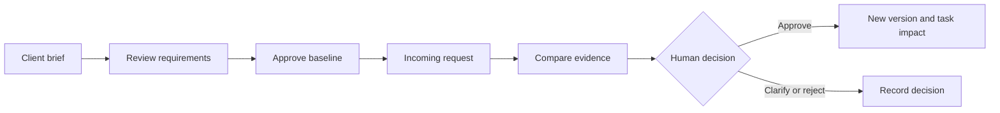
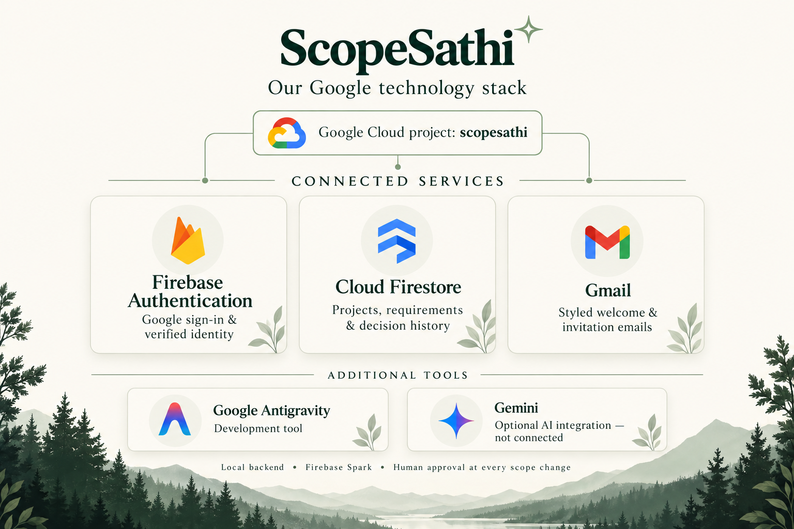

<div align="center">

# ScopeSathi ✧
### Clarity before commitment.
**Turn client requirements and last-minute requests into clear, reviewed agreements.**

React · TypeScript · Firebase · Firestore · Gmail · Optional Gemini

[Live app](https://scopesathi-api-112358672382.europe-west1.run.app) · [Features](#features) · [Get started](#get-started) · [Documentation](docs/README.md) · [Architecture](docs/ARCHITECTURE.md) · [Google stack](#google-stack)
</div>


*Actual application screenshot. Workspace screenshots below use demonstration data; see [image provenance](docs/images/README.md).*

## Hackathon review and verification

The current upgrade adds a client change report with print-to-PDF, evidence wording differences, saved change traceability, next-step guidance and a public worked example. AI proposes; verified user roles and human approval control changes.

**Start here:** [QA report and fixes](docs/HACKATHON_QA_REPORT.md) · [AI evaluation](docs/AI_EVALUATION.md) · [Three-minute demo script](docs/SUBMISSION_WALKTHROUGH.md).

Local automated checks and disposable Firestore workflows pass. Latest local model probes returned provider 402/403, so no new accuracy claim is made. Public cloud health/Firestore checks pass; authenticated hosted AI, SMTP and interactive browser/printing checks remain release work. The worked example is labeled illustration, not live inference. A recorded demo link will be added only after recording.

## Documentation

For the deployed service and hosted email setup, see **[Cloud Run release guide](docs/CLOUD_RUN_RELEASE.md)**. For the reasoning behind every cloud setting, see **[Deployment decisions: what, why, and how](docs/DEPLOYMENT_DECISIONS.md)**.

Start at the **[documentation hub](docs/README.md)** for the complete project guide. See the **[QA audit and bug fixes](docs/QA_REPORT.md)** for current evidence and remaining release checks.

| Understand the product | Understand the implementation | Run and maintain it |
| --- | --- | --- |
| [Illustrated product guide](docs/PRODUCT_GUIDE.md) | [Architecture and diagrams](docs/ARCHITECTURE.md) | [Local setup](docs/FREE_SETUP.md) |
| [AI and evidence review](docs/AI_WORKFLOW.md) | [Technology: why and how](docs/TECHNOLOGY.md) | [Configuration](docs/CONFIGURATION.md) |
| [Email and invitations](docs/EMAIL_SETUP.md) | [Data model](docs/DATA_MODEL.md) | [Google deployment](docs/GOOGLE_SETUP.md) |
| [Validation record](docs/VALIDATION.md) | [API reference](docs/API.md) | [Security and operations](docs/SECURITY_OPERATIONS.md) |
| [Contribution guide](docs/CONTRIBUTING.md) | [Rate limits and system design](docs/SYSTEM_DESIGN.md) | [Screenshot provenance](docs/images/README.md) |

## Inside the workspace


*Submitted requests, approved changes and revision rounds are counted separately.*


*Affected work is flagged for human review. More screenshots: [product guide](docs/PRODUCT_GUIDE.md).*

## Why ScopeSathi?

“Could we add just one more feature?” can change a project's deliverables and expectations. ScopeSathi gives freelancers and small software teams a shared record of what was agreed, what changed, who approved it and which tasks need attention.

**Hackathon theme:** Future of Work & Enterprise Productivity.

> AI proposes. Your team decides. Only an explicit human decision changes the approved scope.

## The workflow



For example, a client approves sign-in before checkout, then requests guest checkout. The reviewer examines the original requirement, exact client quote, proposed wording and linked tasks. Approval preserves the previous baseline and flags affected work.

## Features

| Workspace | Capabilities |
|---|---|
| **Overview** | Setup checklist, pending decisions, revision allowance and affected tasks |
| **Approved scope** | Structured intake, selectable-text PDF/TXT upload, editable requirements, stable IDs, source passages and version comparison |
| **Change requests** | Search, filters, multiple findings, addition/modification/removal/clarification/no-change classifications and human decisions |
| **Tasks & impact** | Requirement links, task status, work needing review and CSV exports |
| **Decision history** | Reviewers, reasons, timestamps, preserved versions and JSON exports |
| **Settings** | Account details, connection status, project access and revision policy |

### Revision rounds

Configure an included allowance, group related requests into a round and count each approved new-scope round once. Corrections, rejection, clarification and no-change decisions do not consume it. Beyond-allowance approval requires a recorded separate agreement. Owners can configure an extra-round price and designated client. A cost meter shows estimates, accepted quotes and manually recorded invoice references. Priced extra rounds require client acceptance before scope approval. Accepted rates stay fixed, and no payment is collected. See [revision pricing setup](docs/REVISION_PRICING.md).

### Onboarding and collaboration

- Public home page, Google sign-in, first-visit tour and optional tour remembrance.
- Responsive workspace, profile controls and branded loading transitions with reduced-motion support.
- Owner, reviewer, editor and viewer permissions enforced by the backend.
- Seven-day invitations, owner revocation and acceptance using the matching verified Google account.
- Owner confirmation to invite someone who has not signed up yet.
- Branded HTML welcome, invitation and access emails, plain-text alternatives and persisted delivery states.

Invalid email formats are rejected. A correctly formatted address cannot be guaranteed to exist or be free of typos. SMTP acceptance is not proof of inbox delivery.

## Google stack



| Technology | Role | Development status |
|---|---|---|
| **Firebase Authentication** | Google sign-in and verified identity | Connected |
| **Cloud Firestore** | Projects, briefs, requirements, versions, tasks, permissions, history and mail queue | Persistence verified |
| **Gmail SMTP** | Styled welcome and invitation emails | Local checks exist; hosted secret and authenticated Scheduler setup required |
| **Google Cloud project** | Firebase infrastructure context | Existing project: `scopesathi` |
| **Google Antigravity** | Development tool | Included in the project toolset |
| **Gemini** | Optional extraction and change analysis | Flash-Lite extraction and change-review smoke checks pass; human review required |
| **Cloud Run** | Serves the React app and backend API | Owner verified public loading and Google sign-in on 15 October 2026 |
| **Firebase Hosting** | Optional alternate frontend address | Rewrite points to the existing Cloud Run service; not verified as deployed |

The graphic illustrates the stack; it is not a Google endorsement. Each installation's configuration determines available capabilities. Manual review works without Gemini; prepared demo examples are not live AI.

## Deployment design and cost control


*Illustrated design: source deployment, authenticated application requests and scheduled mail. The amber mail path requires separate setup. [Read the architecture](docs/ARCHITECTURE.md) or [image provenance](docs/images/README.md).*

The public prototype uses **Cloud Run automatic scaling with minimum 0 and maximum 1 instance**, request-based billing, concurrency **20**, and a **60-second** request timeout. Minimum zero permits idle scale-down; maximum one deliberately limits capacity. The default CPU and concurrency utilization targets remain 60%. These are prototype settings, not measured throughput or high-availability guarantees.

| Decision | Reason | Tradeoff |
| --- | --- | --- |
| Request-based billing and minimum zero | Match intermittent usage without reserving a warm instance | Cold starts; background polling is unsuitable for reliable hosted mail |
| Maximum one instance | Restrict compute expansion | Requests can wait or fail during bursts |
| Concurrency 20 | Starting point for overlapping requests and document processing | Needs load testing; not 20 users or a requests-per-minute limit |
| Firestore transactions | Atomically record scope changes, task impact and history | Whole-project reads and aggregate size limit prototype scale |
| Attached runtime account and secret references | Avoid shipping long-lived Admin keys or SMTP passwords in Git | Cloud IAM and secrets require separate configuration |
| Authenticated scheduled email batches | Process outbox work while the request has CPU | Scheduler and SMTP setup still required; delivery is not instantaneous or exactly once |

Operators should configure billing alerts and eligible service-specific spending controls for their own account. **Vertex AI requires its own service cap.** Alerts, service caps, rate limits and prepaid credit do not form a guaranteed total spending ceiling. Compute, AI, storage, builds and other services can contribute costs.

Read the **[complete deployment rationale](docs/DEPLOYMENT_DECISIONS.md)** for settings, architecture diagrams, role boundaries, cold starts, cost monitoring, CI/CD, rollback and remaining limitations. Read the **[release guide](docs/CLOUD_RUN_RELEASE.md)** for console setup steps. Deployment screenshots establish public loading and sign-in; they do not establish live SMTP delivery, a particular current instance count, or exhaustive model accuracy.

## Get started

Requires **Node.js 22+** and npm.

```sh
npm ci
cp .env.example .env
npm run dev
```

Open **http://127.0.0.1:5173/**. The API uses `PORT` from `.env` (example: 8080); Vite forwards API requests to it. **Do not overwrite an existing configured .env.**

The example starts in isolated local demo mode. Try the guest-checkout example, edit the proposal, resolve questions and approve it to see a new scope version and affected task.

### Firebase and Firestore

1. Register a Firebase web app, enable Google sign-in and authorize your development hosts.
2. Create the default Firestore database; keep direct browser access denied.
3. Set `APP_MODE=firebase`, `STORAGE_BACKEND=firestore`, your project ID and public web configuration in `.env`.
4. Configure Application Default Credentials or an Admin JSON file **outside the repository**:

```sh
npm run firestore:configure -- /absolute/private/path/admin-key.json
```

5. Restart the backend and check the connection in Settings.

Browser sign-in does not authenticate the backend to Firestore. Existing local projects have an explicit preview-and-copy migration; IDs/history are preserved, duplicates checked and originals retained. See [free setup](docs/FREE_SETUP.md).

## Configuration

Private values belong in ignored **.env** or a deployment secret store. Commit **.env.example** with placeholders only. Keep Admin JSON files outside the repository; store only their path in .env.

| Variable | Purpose |
|---|---|
| `APP_MODE` | demo, firebase (local backend), or google (cloud) |
| `PORT`, `STORAGE_BACKEND` | API port and explicit storage choice |
| `GOOGLE_CLOUD_PROJECT` | Firebase / Cloud project ID |
| `GOOGLE_APPLICATION_CREDENTIALS` | Private credential-file path; optional with other ADC methods |
| `FIREBASE_WEB_CONFIG` | Public browser configuration, not an Admin credential |
| `GEMINI_API_KEY`, `GEMINI_MODEL` | Optional backend AI settings |
| `SMTP_USER`, `SMTP_PASS`, `EMAIL_FROM` | Backend sender configuration |
| `EMAIL_ENABLED` | Enable the mail worker |
| `APP_PUBLIC_URL` | `https://scopesathi-api-112358672382.europe-west1.run.app` for the current deployment |
| `MAIL_TRIGGER_SERVICE_ACCOUNT` | Exact OIDC identity allowed to invoke hosted email batches |
| `EMAIL_LOCAL_TEST` | Explicit host-Mac email testing |

See [email setup](docs/EMAIL_SETUP.md). Cloud Run mail is processed by the authenticated Scheduler endpoint; the local backend uses polling. The Scheduler and SMTP secrets must be configured separately. Local-test messages explain that localhost works only on the host Mac. Invitations need a publicly reachable app for remote teammates.

## Approval and security

The backend verifies identity and project access. Source quotes and requirement/task references are validated. Unresolved questions, stale analysis and concurrent edits block approval. Baseline history is preserved; tasks are flagged rather than silently rewritten.

The supplied Firestore rules deny direct browser access. Deploy and verify them for your environment. Admin SDK access is governed by backend permission checks and IAM.

.env, local data, credential files and build caches are excluded from Git and build uploads. Review both working files and the Git staging area before publishing; ignore rules do not remove previously tracked secrets.

## Testing

```sh
npm run check
npm test
npm run build
```

Tests cover approvals, evidence, permissions, concurrent edits, revision accounting, persistence and invitations. Optional real-service checks create temporary fixtures and require a deliberately configured Firebase environment:

```sh
npm run test:firestore
npm run test:invitations
```

Local tests do not prove a new deployment, live Gemini or inbox delivery. See [validation notes](docs/VALIDATION.md).

## Deployment and limits

The public app is deployed at **[ScopeSathi on Cloud Run](https://scopesathi-api-112358672382.europe-west1.run.app)** in `europe-west1`, service `scopesathi-api`. The owner verified loading and Google sign-in. Hosted SMTP and live Vertex workflows still need their own verification. GitHub pushes to `main` trigger builds and deployments; see the [release and email guide](docs/CLOUD_RUN_RELEASE.md). Free allowances are not a guarantee of zero cost. See [deployment guide](docs/GOOGLE_SETUP.md); provide secrets through the deployment environment rather than uploading .env.

Prototype limits: no OCR for scanned PDFs, meeting recording, Jira sync or automatic billing; live AI requires configuration; project size and per-instance rate limits apply. Failed or uncertain SMTP submissions need review before retrying to avoid duplicates.

## Repository map

```text
src/       React workspace, onboarding and authentication
server/    API, persistence, analysis, invitations and mail worker
shared/    Models and validation
tests/     Workflow, access and integration checks
scripts/   Configuration and deployment helpers
docs/      Guides, architecture, validation and images
```

[All documentation](docs/README.md) · [Architecture](docs/ARCHITECTURE.md) · [Free setup](docs/FREE_SETUP.md) · [Email setup](docs/EMAIL_SETUP.md) · [Google deployment](docs/GOOGLE_SETUP.md)

## License

Licensed under the [MIT License](LICENSE).

**Built for thoughtful teams. Every change deserves a clear decision.**

### Clean document extraction

The draft review groups wrapped clauses, separates document metadata/background, preserves exact evidence, and offers category filters for features, constraints, acceptance and exclusions. With a verified Gemini setup it also provides semantic scope summaries and review questions. Local cleanup stays clearly labelled as rule-based, and model failures never silently switch engines. See [AI workflow and setup](docs/AI_WORKFLOW.md).
