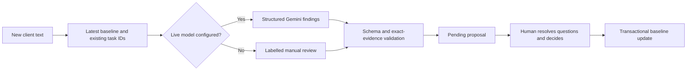

# AI, evidence and human review

[Documentation home](README.md)

## Extraction

A pasted/extracted brief enters server/ai.ts. Configured Gemini returns structured requirements with stable IDs, editable wording and contiguous source quotes. Zod validates the response, then domain validation checks quotes against the actual brief.

Without live AI, the app splits non-empty lines into editable requirements, splitting long passages without silently discarding text. More than 30 sections requires a shorter brief. This is deterministic text handling, not semantic AI analysis.

## Change matching

Each finding identifies its change kind, requirementId, currentQuote, requestQuote, proposedText, questions and taskIds. Standalone additions can have an empty requirement reference. Multiple findings are allowed; conflicting changes and fabricated references are rejected.

## Model configuration

firebase mode uses GEMINI_API_KEY and GEMINI_MODEL with the Developer API. google mode uses Vertex AI, project/location and ADC. The request timeout is 45 seconds; generation requests JSON schema output with a 7,000-token output limit. Model access/availability must be verified for the installation.

The instruction treats client text as untrusted data and rejects embedded instructions to approve, invent facts or expose secrets. A prompt alone is insufficient protection: server validation and reviewer approval form the actual write boundary.

## Failure and accuracy

A model/schema failure returns 502 and applies no decision. Exact substring validation proves text exists, not that the interpretation is correct. Do not report automatic legal scope, estimates, precision or time savings without evaluation. The known demo checkout response is prepared sample output and must not be used as evidence of model performance.

## Evaluation plan

Use permitted or synthetic briefs with labelled additions, modifications, removals, no-change and ambiguity. Hold out cases from prompt tuning. Record false matches, missed changes, quote correctness, unresolved ambiguity and unauthorized mutation count. Include malicious instructions inside source text. Live Gemini quality has not been revalidated by the documentation task.
