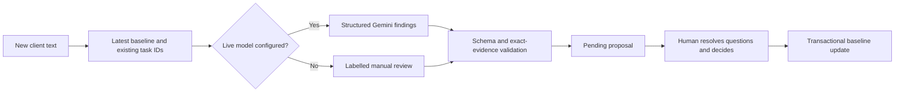

# AI, evidence and human review

[Documentation home](README.md)

## Extraction

A pasted/extracted brief enters server/ai.ts. Configured Gemini returns structured requirements with stable IDs, editable wording and contiguous source quotes. Zod validates the response, then domain validation checks quotes against the actual brief.

Without live AI, document cleanup groups wrapped labelled clauses, separates headings/branding/page markers and background, removes duplicate clauses, and preserves exact source spans. Context passages stay visible in the review and the original brief is retained. Categories are editable. This is rule-based cleanup, not semantic AI analysis. Over 30 clauses requires consolidation. Unknown document layouts still need human review.

## Change matching

Each finding identifies its change kind, requirementId, currentQuote, requestQuote, proposedText, questions and taskIds. Standalone additions can have an empty requirement reference. Multiple findings are allowed; conflicting changes and fabricated references are rejected.

## Model configuration

firebase mode uses GEMINI_API_KEY and GEMINI_MODEL with the Developer API. google mode uses Vertex AI, project/location and ADC. The SDK transport timeout is 16 seconds per attempt, with an independent 40-second application deadline that also aborts the request; generation requests JSON schema output with a 4,096-token output limit and low thinking for Gemini 3 models. Model access/availability must be verified for the installation.

The instruction treats client text as untrusted data and rejects embedded instructions to approve, invent facts or expose secrets. A prompt alone is insufficient protection: server validation and reviewer approval form the actual write boundary.

## Failure and accuracy

A model/schema failure returns 502 and applies no decision. Exact substring validation proves text exists, not that the interpretation is correct. Do not report automatic legal scope, estimates, precision or time savings without evaluation. The known demo checkout response is prepared sample output and must not be used as evidence of model performance.

## Evaluation plan

Use permitted or synthetic briefs with labelled additions, modifications, removals, no-change and ambiguity. Hold out cases from prompt tuning. Record false matches, missed changes, quote correctness, unresolved ambiguity and unauthorized mutation count. Include malicious instructions inside source text. Live Gemini quality has not been revalidated by the documentation task.

## Gemini setup and review experience

Save a private AI Studio key in a text file outside the repository. Run npm run ai:configure -- /absolute/path/private-key.txt model-name. Choose a supported model from your project; the script verifies extraction and change matching on synthetic input before writing the ignored backend environment file with restrictive permissions. It changes no billing settings and sends no real client brief during setup. Restart the backend after success.

Extraction now returns a scope summary, review questions, categories (feature, constraint, acceptance, exclusion) and exact quoted context passages excluded from requirements. The editor shows the actual engine, category filters, editable categories and evidence. Gemini evidence is validated before presentation; a model failure never silently falls back to local output. Approval remains explicit. Auth/model/quota/busy failures have distinct messages.

## Numbered PDF regression (15 October 2026)

The original Sunday Store PDF has six numbered features. Each wrapped R1–R6 clause stays one complete requirement, including negative boundaries. Acceptance criteria, exclusions and revision terms remain visible in supporting agreement/context, and the original brief is passed to Gemini for later change review. Metadata and footers never become feature cards. Numbered-feature coverage and complete exact quotes are validated before display.

A real Developer API extraction using the supplied private key and gemini-3.8-flash returned six validated requirements for this exact PDF. The local upload/extraction regression also returns six. This is a single successful live extraction, not a guarantee of accuracy or availability. Separate change-analysis probes encountered temporary 503/timeouts and remain unverified for this session. The current backend configuration enables Gemini; failed requests preserve the draft and do not silently fall back to local extraction.

If an already-open tab shows the old Extract requirements button and 27 draft lines, refresh the page and run Analyse with Gemini again. Restart API and Vite after configuration changes. Approved versions remain immutable and require reviewed amendment proposals.

## Slow-service recovery

Extraction errors appear next to the extraction button and preserve the existing draft. The browser fetch has a 55-second deadline, and the AI request has a 40-second hard deadline even if the SDK transport does not settle. Prepare without AI explicitly requests local cleanup; its output is labelled no AI calls. There is no silent fallback. The exact Sunday Store PDF produces six feature cards through this path. Live service probes on 15 October also returned 503 and 504; configured does not guarantee availability.

## Verified Gemini integration fix — 15 October 2026

Current local model: gemini-3.5-flash-lite. Minimal probes with the same key succeeded on Flash-Lite while 3.8 Flash timed out. The previous nested generation schema also produced 400 INVALID_ARGUMENT during change analysis. Generation now sends a simpler schema with types, enums, properties and required fields; all size bounds remain enforced by the original Zod schema after generation. PDF quote recovery permits whitespace differences only and restores the actual source passage. Paraphrases still fail evidence validation. Change analysis receives approved IDs and text without competing PDF source wording.

The SDK makes at most two attempts for configured transient status codes, with short backoff, 16-second transport timeouts and an overall 40-second deadline. It does not retry 400/401/403 or quota failures automatically.

The setup probe verified extraction and three change findings before saving the ignored environment configuration. Two subsequent full original-PDF extractions each returned six validated features (approximately 8.9 and 6.6 seconds). A change-review call returned a valid clarification finding with a source quote and questions about guest orders. This confirms live requests and validation, not exhaustive semantic accuracy or guaranteed provider uptime. No project was saved by these probes.

References: [structured output schema support](https://ai.google.dev/gemini-api/docs/structured-output), [Flash-Lite model](https://ai.google.dev/gemini-api/docs/models/gemini-3.5-flash-lite), [transient error retries](https://ai.google.dev/gemini-api/docs/troubleshooting).

## Hosted configuration boundary

The selected Vertex endpoint (`global`) is independent of the Cloud Run compute region (`europe-west1`). The local Developer API key is not required for google-mode ADC model calls. Default configured model text is not proof of live model access; evaluate the deployed workflow after IAM/API/quota changes. [Deployment rationale](DEPLOYMENT_DECISIONS.md#ai-request-lifecycle) explains the deadline layers and cost boundaries.
