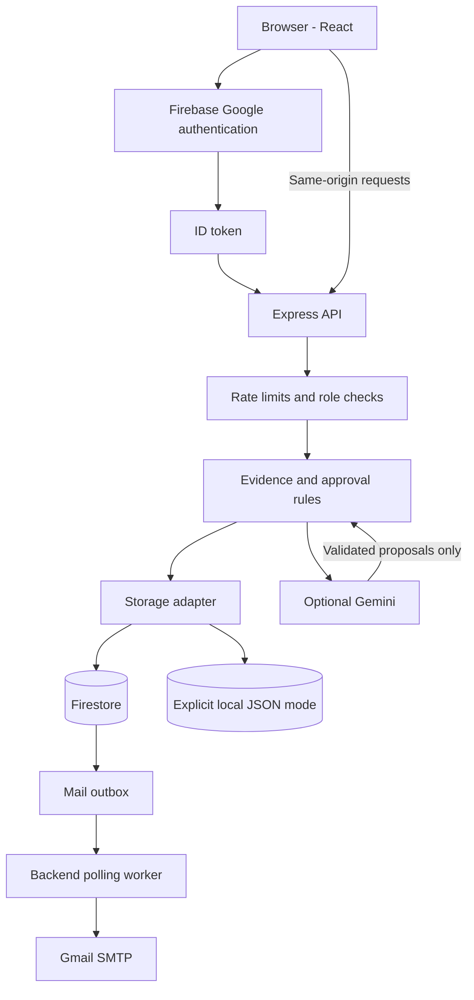
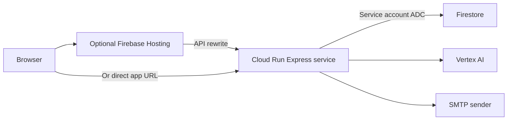

# Architecture

[Documentation home](README.md) · [Data model](DATA_MODEL.md)

ScopeSathi is a React client and one Express backend. The backend owns authorization, validation and persistence so approval rules are consistent across browsers.



Storage branches are configuration alternatives, not failover. Firestore failures do not switch to local storage. Browsers do not write directly to Firestore. Email currently uses SMTP, not Gmail API.

## Modes

| Mode | Identity | Storage | Analysis |
| --- | --- | --- | --- |
| demo | Loopback demo actor | Local JSON | Known sample/manual |
| firebase | Verified Google user | Explicit local or Firestore | Manual or Gemini Developer API |
| google | Verified Google user; revocation check | Firestore | Vertex AI Gemini |

Production and Cloud Run reject local modes. Google mode requires a model configuration.

## Approval transaction

```mermaid
sequenceDiagram
  participant B as Browser
  participant A as API
  participant F as Firestore
  B->>A: Decision, revision and reason
  A->>A: Verify token and rate budget
  A->>F: Read project in transaction
  A->>A: Check role, revision, evidence, questions and allowance
  alt Valid decision
    A->>A: Apply findings, append version/history, flag tasks
    A->>F: Write project with incremented revision
    F-->>A: Commit confirmed
    A-->>B: Updated project
  else Invalid or stale
    A-->>B: Error; no confirmed change
  end
```

AI generation occurs outside transactions to avoid repeated calls during transaction retries. The subsequent write checks the original project revision. Local writes are serialized and use temporary-file rename, not distributed locking.

## Source map

| Module | Responsibility |
| --- | --- |
| src/App.tsx, WorkspacePanels.tsx | Navigation, editors, comparisons and tasks |
| src/Welcome.tsx, Notifications.tsx | Home, tour, preferences and invitation inbox |
| src/api.ts | Firebase session, bearer tokens, downloads |
| shared/model.ts | Schemas, types, legacy defaults and round summaries |
| server/index.ts, protection.ts | HTTP routes, limits and lifecycle |
| server/domain.ts | Authorization and approval invariants |
| server/store.ts, database.ts, migration.ts | Storage, connection verification and explicit migration |
| server/ai.ts | Structured generation and manual/sample modes |
| server/invitations.ts, email.ts | Invitation transactions and outbox |

## Intended deployment



Cloud Run serves the bundled frontend too. This is a deployment design, not evidence of a completed deployment. Use attached service-account credentials and a secret store.

## Tradeoffs

One project document makes scope/task/history changes atomic but requires whole-project reads and a 700 KB application cap. Lists are not paginated. Growth needs subcollections, pagination and explicit data migration. Per-process limiters are not global budgets. PDF parsing is in-process. The mail polling timer is not a durable scheduler and is unreliable on sleeping/scale-to-zero hosts. These are production gaps, not implemented distributed services.
