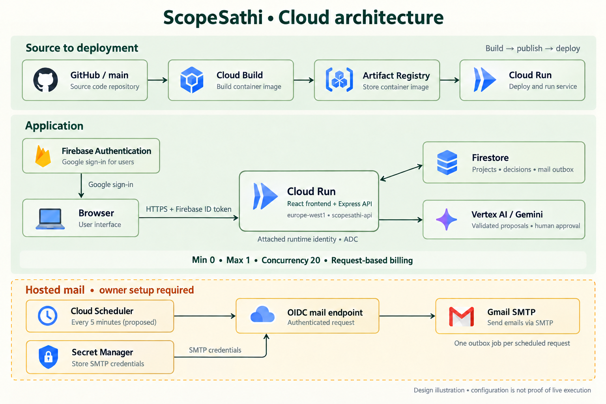
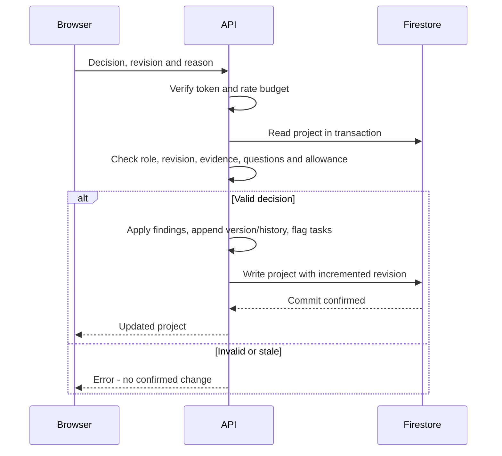

# Architecture

[Documentation home](README.md) · [Data model](DATA_MODEL.md)

ScopeSathi is a React client and one Express backend. The backend owns authorization, validation and persistence so approval rules are consistent across browsers.

*Architecture illustration. Cloud Run serves React and Express together; only the backend accesses Firestore and Vertex AI. The amber mail section requires owner setup. [Image provenance and generation prompts](images/GENERATION.md).*

Storage branches are configuration alternatives, not failover. Firestore failures do not switch to local storage. Browsers do not write directly to Firestore. Email currently uses SMTP, not Gmail API.

## Modes

| Mode | Identity | Storage | Analysis |
| --- | --- | --- | --- |
| demo | Loopback demo actor | Local JSON | Known sample/manual |
| firebase | Verified Google user | Explicit local or Firestore | Manual or Gemini Developer API |
| google | Verified Google user; revocation check | Firestore | Vertex AI Gemini |

Production and Cloud Run reject local modes. Google mode requires a model configuration.

## Approval transaction

AI generation occurs outside transactions to avoid repeated calls during transaction retries. The subsequent write checks the original project revision. Local writes are serialized and use temporary-file rename, not distributed locking.

## Source map

| Module | Responsibility |
| --- | --- |
| src/App.tsx, WorkspacePanels.tsx | Navigation, editors, comparisons and tasks |
| src/Welcome.tsx, Notifications.tsx | Home, tour, preferences and invitation inbox |
| src/api.ts | Firebase session, bearer tokens, downloads |
| shared/model.ts | Schemas, types, legacy defaults and round summaries |
| server/index.ts, protection.ts | HTTP routes, limits and lifecycle |
| server/domain.ts | Authorization and approval invariants |
| server/store.ts, database.ts, migration.ts | Storage, connection verification and explicit migration |
| server/ai.ts, ai-observability.ts, ai-errors.ts | Structured generation, server-owned provenance and actionable failure handling |
| shared/review.ts, src/ReviewInsights.tsx | Historical evidence selection, bounded diff, task traceability and client report preview |
| src/visible-polling.ts | Visibility-aware notification polling and lifecycle cleanup |
| eval/, scripts/evaluate-ai.ts | Synthetic project-level evaluation splits, scoring and explicit live-run tooling |
| server/invitations.ts, email.ts | Invitation transactions and outbox |
| server/mail-trigger.ts | Authenticated Google OIDC mail batch endpoint |
| shared/deployment.ts | Public deployment metadata; no credentials |

## Deployment topology

The architecture image above shows the direct Cloud Run topology. Optional Firebase Hosting can serve the frontend and rewrite API requests to Cloud Run; it is not required for the live service.

Cloud Run serves the bundled frontend and API at [the live ScopeSathi address](https://scopesathi-api-112358672382.europe-west1.run.app). The owner verified loading and sign-in; hosted SMTP and Vertex calls require separate verification. Use attached service-account credentials and a secret store.

## Tradeoffs

One project document makes scope/task/history changes atomic but requires whole-project reads and a 700 KB application cap. Lists are not paginated. Growth needs subcollections, pagination and explicit data migration. Per-process limiters are not global budgets. PDF parsing is in-process. Local mail polling is unreliable on sleeping hosts. Cloud Run instead provides an authenticated scheduled batch endpoint; the owner must configure SMTP secrets and Scheduler before hosted sending works. Shared limiters and data-growth improvements remain production gaps. See [release setup](CLOUD_RUN_RELEASE.md).

## Why the deployment settings matter

The [complete deployment decisions](DEPLOYMENT_DECISIONS.md) explain how the selected compute bounds, timeouts, public ingress, backend identity, secret management and billing model support this topology. They also distinguish owner-verified deployment evidence from configuration that still needs cloud setup or testing. [Release operations](CLOUD_RUN_RELEASE.md) explains updates, mail provisioning and recovery.
