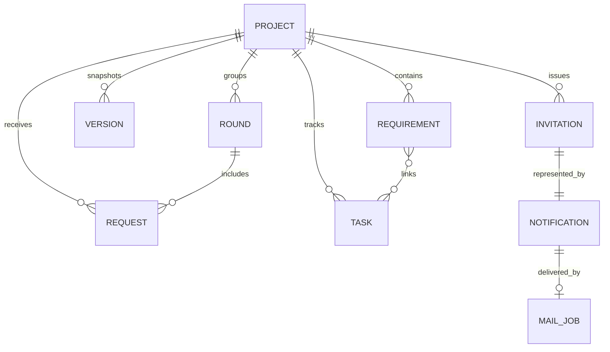

# Data model and persistence

[Documentation home](README.md) · Source: shared/model.ts, server/store.ts, server/invitations.ts

## Firestore collections

| Collection | Purpose |
| --- | --- |
| projects/{projectId} | Project aggregate: owner/membership, intake, brief, current requirements, versions, requests, tasks, decisions, rounds, policy and invitations |
| users/{uid} | First-session record supporting welcome deduplication |
| notifications/{id} | Welcome, invitation and access notices with recipient and state |
| mailOutbox/{id} | Recipient/content and persisted SMTP delivery state |

This is a logical relationship diagram. Requirements, versions, tasks and requests are nested in the project document, not separate Firestore collections.

## Identity and concurrency

Project IDs are UUIDs; requirement IDs remain stable within a project. The owner UID identifies ownership, while verified lowercase email binds membership. memberEmails supports project-list queries. Every ordinary project update supplies its last-known integer revision; a stale revision receives 409. Firestore transactions atomically update the aggregate and increment revision.

Baseline snapshots are immutable through ordinary workflow, not cryptographically immutable or a regulatory audit store. Administrators with database access can modify data. Initial intake/brief and approved snapshots retain evidence; uploaded PDF bytes are not retained.

## Revision accounting

Rounds have IDs, names, creators and timestamps. Requests record category and roundId. Approved new-scope changes consume distinct round IDs, not one allowance per finding. Corrections and non-change decisions are excluded. Lowering allowance does not erase history. A separate agreement is recorded for an approval beyond the allowance.

## Size and queries

The application caps serialized projects at 700,000 bytes, below Firestore's document ceiling. Whole-project reads and unpaginated lists are suitable only for a bounded prototype. Split history/requests into subcollections and add pagination before large projects; maintain atomic approval guarantees during that redesign.

## Local storage and migration

Local mode saves projects.json under the configured data directory; firebase local mode uses .data/firebase-local by default. Writes serialize within one process and use rename. Do not share this file between multiple writing servers.

Firestore is selected explicitly. Failed cloud writes are errors, never silent local successes. Migration previews owned local projects and a canonical fingerprint. Import verifies the preview, preserves IDs/history, rejects conflicting IDs and recognizes identical imports. Local originals remain until independently verified; migration is not automatic.

Exports are user-facing snapshots. Project deletion removes the project aggregate; it is not a guaranteed purge of separate notifications, outbox records, infrastructure backups or logs. A complete retention/deletion policy remains deployment work.
