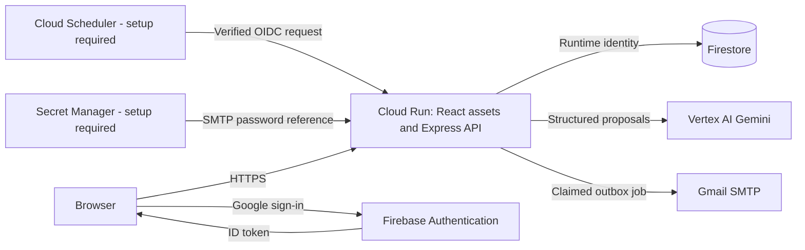
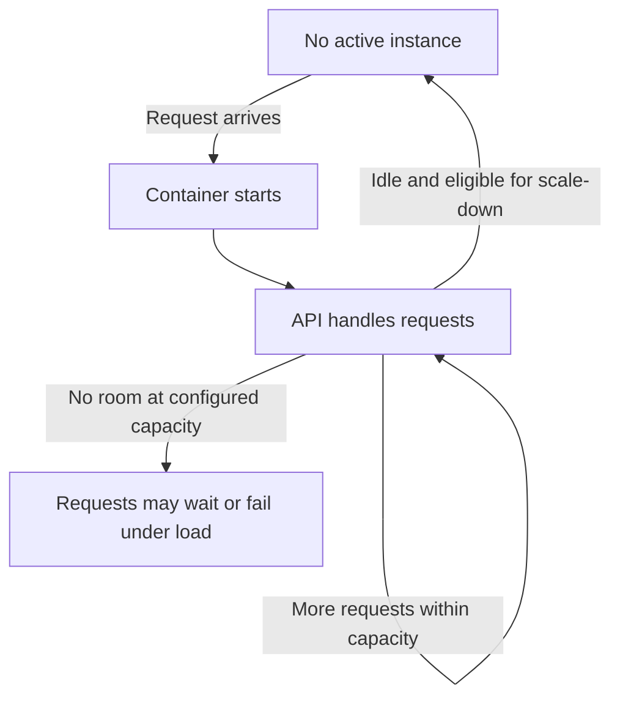
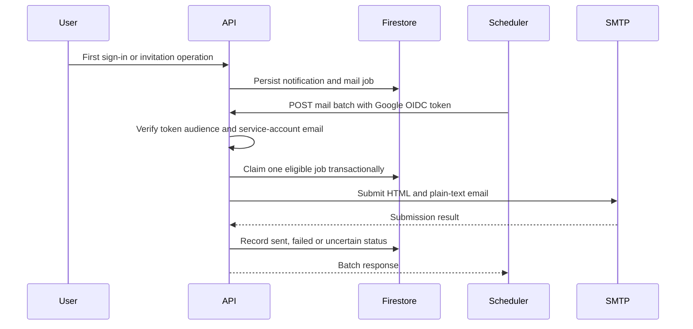

# Deployment decisions: what, why, and how

[Documentation home](README.md) · [Architecture](ARCHITECTURE.md) · [Release instructions](CLOUD_RUN_RELEASE.md) · [Backend protections](SYSTEM_DESIGN.md)

Updated **16 October 2026** against repository code and the owner's deployment screenshots. Live app: **[ScopeSathi](https://scopesathi-api-112358672382.europe-west1.run.app)**.

## What is verified

| Evidence | What it establishes | What it does not establish |
| --- | --- | --- |
| Successful Cloud Build screenshot | Source commit built, pushed and deployed successfully | Every feature works in that revision |
| Public application and Google sign-in screenshots | The deployed frontend loads and the authorized-domain setup permits login | Live AI response quality or hosted SMTP delivery |
| Console configuration screenshots | Values selected during setup, including concurrency 20 and timeout 60 seconds | Current settings after later edits, actual instance count or billed usage |
| Local automated checks | Tested domain rules, rendering, link generation and scheduled-mail authorization | Live cloud IAM, Scheduler execution or recipient inbox delivery |

Read current settings from Cloud Run before making a deployment claim. The mail Scheduler, SMTP secrets and Vertex spend cap require separate owner setup/verification. Descriptions of those components below explain the implemented design and intended configuration, not proof they are running.

## Why this architecture

ScopeSathi uses one Express application to serve both the built React frontend and `/api`. Firebase authenticates humans; the backend checks membership and review permissions; Firestore retains the agreement and decisions. Vertex AI proposes changes, while human approval controls writes. This keeps the prototype understandable and avoids maintaining a separate frontend API origin.

Firestore is persistent state; a Cloud Run container is replaceable compute. Local demo storage is a development alternative, never automatic failover after a cloud failure. Firebase Hosting is optional and is not required for the current direct Cloud Run URL.

## Cloud Run settings and reasons

| Setting | Prototype choice | Why it is used | Tradeoff / verification |
| --- | --- | --- | --- |
| Project / service | `scopesathi` / `scopesathi-api` | One identified deployment for the prototype | Check the selected project before any change |
| Region | `europe-west1` | Preserves the service location selected during setup | Not a claim of lowest latency for India or alignment with Firestore's actual location; cross-region calls can add latency and transfer costs |
| Billing | Request-based | Fits intermittent browser/API traffic | Ordinary idle compute is not continuously billed with minimum zero; processing/startup/shutdown and other services can cost money |
| Scaling | Automatic | Starts capacity as requests arrive and permits scaling down | Maximum one deliberately prevents ordinary scale-out beyond a single instance |
| Service minimum instances | `0` | Avoids reserving an always-warm instance | First request after scale-to-zero can be slower |
| Service maximum instances | `1` | Restricts prototype compute expansion | Burst capacity and availability are limited; it is not a guaranteed monetary ceiling |
| Revision scaling | No explicit overrides in console setup | Keeps the service-level policy easy to reason about | Revisions may show a platform default; inspect both levels. The alternate CLI script also supplies a revision maximum of one |
| CPU utilization target | Default `60%` | Retains the platform's standard scaling signal until measurements justify tuning | A target, not a CPU usage cap or billing percentage |
| Concurrent-request utilization target | Default `60%` | Gives the autoscaler a request-load signal | Not a count of requests or users; no extra instance can be added beyond the effective maximum |
| Maximum concurrency | `20` per instance | Conservative starting point for overlapping API work and PDF processing | Not benchmarked capacity; long AI calls occupy slots. It is not 20 users or 20 requests per minute |
| CPU / memory | Start with `1 vCPU / 512 MiB` | Small container allocation for a prototype | Confirm actual deployed values and measure memory/latency; PDF parsing can increase memory usage |
| Request timeout | `60 seconds` | Allows normal operations and bounded AI analysis to return | A timeout response does not guarantee downstream work was cancelled |
| Startup CPU boost | Enabled in console setup | Reduces startup delay by temporarily increasing CPU | Boosted CPU can be billed during startup; measure the benefit instead of calling it free |
| Execution environment | Default | Lets Cloud Run choose a compatible execution environment | No claim that a specific generation was selected or optimized |
| Container port | `8080`, supplied through `PORT` | Matches the Docker/runtime contract | Backend listens on `0.0.0.0` in google mode |
| Command / arguments | Blank overrides | Uses the Dockerfile's `npm start` | Overriding it can accidentally start the wrong process |
| Public access / ingress | Public access and ingress All | Browsers and evaluators can reach the website | Network reachability is not authorization to project data |
| Custom URL | None configured | Uses Google's HTTPS service URL without a domain purchase | A future hostname requires Firebase domain authorization, mail URL and Scheduler-audience updates |

The choices are prototype tradeoffs, not claims of high availability or unlimited capacity. The platform's [autoscaling](https://docs.cloud.google.com/run/docs/about-instance-autoscaling), [concurrency](https://docs.cloud.google.com/run/docs/about-concurrency), [CPU configuration](https://docs.cloud.google.com/run/docs/configuring/services/cpu), and [billing](https://docs.cloud.google.com/run/docs/configuring/billing-settings) documentation describe the underlying mechanisms.

## How autoscaling behaves here

1. At zero instances, a request can trigger a cold start. Node starts, credentials initialize and the application begins listening. Startup CPU boost may shorten this period.
2. While active, the instance can receive overlapping requests up to its configured concurrency. For example, five waiting AI analyses and ten ordinary API requests represent 15 in-flight requests, not necessarily 15 distinct users.
3. The default utilization targets inform scaling, but the configured maximum restricts expansion. With maximum one, extra demand can queue or fail; no latency or throughput guarantee has been established.
4. When traffic stops, Cloud Run can scale to zero. Open browser polling and a configured Scheduler can create more requests, so simply leaving the page open is not necessarily zero activity.

These are independent controls: instance count controls containers; concurrency controls overlapping requests in each container; rate limits control frequency over time; spending controls monitor or pause selected billable services. None substitutes for the others.

## Runtime, networking and security choices

| Choice | Why / how | Limitation |
| --- | --- | --- |
| Multi-stage Docker build | `npm ci`, type-check/build, then remove development dependencies; runtime contains built assets and backend | Node tag/dependency upgrades still need review; the production image has not been scanned by this documentation task |
| Non-root `node` user | Reduces container privileges | Does not replace input validation, IAM or dependency maintenance |
| Runtime account `scopesathi-runtime` | Attached ADC identity avoids downloading a long-lived server key | IAM permissions apply to server access; audit them as features change |
| Cloud Datastore User | Allows backend Firestore reads/writes | Broad access within its granted scope; app membership checks remain essential |
| Firebase Authentication Viewer | Supports user lookup and revocation checks | Does not grant the app user-management privileges |
| Agent Platform / Vertex AI User | Permits model calls through Vertex AI | Does not prove a particular model is available or free |
| Separate build identity | Builds source, writes images and deploys revisions | Developer Connect read-token access belongs on the build identity, not automatically on the runtime identity |
| Separate mail Scheduler identity | Only the exact verified identity can invoke mail batches | Requires Google OIDC verification and matching audience; a trusted-looking header is insufficient |
| Secret Manager | Supplies the SMTP password through a versioned secret reference | Grant runtime access on the needed secret; code pushes do not create secrets |
| Google-managed encryption | Uses the platform's managed at-rest encryption | No customer-managed KMS lifecycle is configured; HTTPS/TLS is separate transport protection |
| HTTP/2 end-to-end disabled | Express uses ordinary HTTP serving behind Cloud Run's managed frontend | Not a statement that the public endpoint lacks HTTPS |
| Session affinity disabled | Authorization and project state do not depend on reaching the same container | In-memory counters still reset or diverge across instances |
| No outbound VPC connector | Current app uses Google service APIs and SMTP without private-network dependencies | Revisit for private resources; it is not a claim that all egress is private |
| No Service Mesh | One backend does not need service-to-service mesh operations | Revisit only when requirements justify the added configuration |
| No Binary Authorization policy | Signed-image admission policy is not part of this prototype | Do not claim image attestation or deployment-policy enforcement |
| No Cloud SQL connection / data volume | Firestore retains data; uploaded PDF bytes are not retained | No relational database, persistent upload storage or OCR pipeline is implemented |

Firebase's public web config identifies the frontend app; it is not an Admin credential or the Gemini API key. Cloud Run's public-access setting does not disable Firebase user checks in Express. Owner/reviewer/editor/viewer permissions still govern project operations. The dedicated mail endpoint is the exception to Firebase user authentication because it independently verifies a service-account OIDC token.

## Application safeguards and their purpose

| Mechanism | Why it exists | How it behaves |
| --- | --- | --- |
| Stable requirement IDs and version snapshots | Review changes without losing the previous agreement | Approved amendments retain IDs where appropriate and append scope history |
| Exact evidence validation | Prevent fabricated source references from being treated as proof | Quotes must match actual source passages; whitespace-only recovery restores original text |
| Human decisions | AI should not silently change client commitments | Reviewers resolve questions and explicitly approve/reject/clarify |
| Optimistic revision checks | Avoid overwriting another user's newer edits | Stale project revisions fail instead of silently winning |
| Firestore transactions | Keep scope, task impact and decision history consistent | Related approval mutations commit together in the project aggregate |
| Project size cap | Keep the prototype aggregate bounded | Serialized projects are capped at 700,000 bytes; pagination/subcollections are future work |
| Request schemas and body limits | Bound malformed or excessive input | Zod validation, 350 KB JSON body cap, single PDF/TXT up to 2 MiB and extracted brief up to 16,000 characters |
| Separate AI and document/manual limits | Expensive model calls should not block uploading or manual recovery | AI budget is eight requests/minute/user; upload/manual budget is 30 |
| Structured logging | Diagnose request failures without logging content | Generated request IDs, route, status and duration; bodies and tokens excluded |
| No-store API responses | Avoid caching private project state in shared caches | Applies to API responses, not a claim of a frontend CDN |
| Graceful shutdown | Give in-flight operations a chance to finish | Stop new connections and allow up to ten seconds to drain; abrupt termination remains possible |

See [the complete rate-limit table](SYSTEM_DESIGN.md#limits), [data model](DATA_MODEL.md) and [API reference](API.md). Firestore Admin SDK bypasses client security rules, so deny-all browser rules alone do not secure server endpoints.

## AI request lifecycle

The current cloud configuration selects `gemini-3.5-flash-lite` through Vertex AI with `GOOGLE_CLOUD_LOCATION=global`. This endpoint setting is independent of the Cloud Run compute region; Belgium compute does not imply all model processing stays in Belgium.

- The browser request deadline is 55 seconds, SDK transport timeout is 16 seconds per attempt, and the application has a 40-second overall AI deadline.
- At most two SDK attempts are configured for selected transient errors. Auth, invalid-input and quota failures are not blindly retried.
- Output is limited to 4,096 tokens. A provider-compatible JSON schema guides generation; full Zod and source-evidence validation follows it.
- Gemini 3 models use low thinking in the current implementation. This is a configuration choice, not proof of semantic accuracy.
- Failure preserves the brief/draft and does not silently label local cleanup as AI output. Manual review remains available.

AI generation happens outside the Firestore transaction so transaction retries do not repeat model requests. The eventual save checks the project's original revision. A successful local Developer API probe does not prove hosted Vertex permissions, quota or response quality. See [AI workflow and evaluation](AI_WORKFLOW.md).

## Email lifecycle and why it differs in the cloud

The authenticated scheduled endpoint awaits delivery work inside an active HTTP request. This avoids relying on a local timer after Cloud Run stops allocating request-based CPU. SMTP secrets, `EMAIL_ENABLED=true`, the exact Scheduler identity and an actual enabled Scheduler job are required; source code alone does not provision them.

The proposed schedule is every five minutes, processing at most one eligible job per invocation. It favors a small prototype over throughput: a backlog can delay delivery substantially. There is no guaranteed immediate delivery, unlimited sending, automatic marketing subscription, or exactly-once SMTP delivery. Sent means SMTP accepted the submission, not that the recipient read or received it. Failed/uncertain jobs need review to avoid duplicate submissions. See [email operations](CLOUD_RUN_RELEASE.md#scheduled-mail-with-scale-to-zero).

## Cost controls and what they actually protect

| Control | Scope | What remains possible |
| --- | --- | --- |
| ₹1,000 prepayment | Credit recorded in the owner's billing account | Not a monthly fee or a guaranteed maximum bill |
| ₹200 monthly alert | Saved alerts-only billing budget; verify its current filters | Sends alerts; does not pause usage |
| ₹100 Cloud Run cap | Saved service cap; verify project/service/status | Can interrupt the website; delayed enforcement can allow overage |
| ₹100 Gemini API cap | Saved Developer API cap; verify key's project | Does not cover Vertex AI |
| Vertex AI / Agent Platform cap | Separate setup still requires confirmation | Model usage is not covered by the Developer API cap |
| Minimum zero / maximum one | Limits idle reservation and compute scale | Continuous requests can still incur compute charges |
| Concurrency and rate limits | Controls simultaneous work and request frequency | Does not cap tokens, database operations or total daily money |

Total costs can include **Cloud Run compute/requests, Vertex tokens, Firestore operations/storage, Cloud Build, Artifact Registry images, Secret Manager, Scheduler, logs and networking**. An enabled service does not by itself imply a fixed monthly charge, but retained resources and actual usage may cost money. Free-tier eligibility and allowances must be checked for the billing account; do not assume an expired trial means all ongoing free allowances disappear or that any allowance guarantees a zero bill.

Budget alerts, spend caps, credit balances and instance limits have different meanings. Eligible spend caps are service-specific, reset monthly and can have enforcement/reporting delays; in-flight/fixed costs may remain. They can also block evaluation traffic. See [Google's spending-cap limits](https://docs.cloud.google.com/billing/docs/how-to/budgets-spend-caps) and [Cloud Run pricing](https://cloud.google.com/run/pricing). No fixed rupee monthly estimate is claimed without traffic, token counts, storage and current account rates.

## How to check usage instead of guessing

1. Cloud Run → `scopesathi-api` → Scaling: confirm service minimum zero and maximum one. Inspect revision settings too.
2. Containers / revision details: confirm billing, allocated resources, concurrency, timeout, account and environment. A console value does not prove the selected model responds.
3. Observability → Metrics: inspect container instance count, request count, latency, CPU and memory. Zero current instances is a measurement, not something this document asserts.
4. Billing → Reports: filter `scopesathi`, group by service and inspect the date range. Reporting delays can hide recent usage.
5. Billing → Budgets & caps: confirm each cap's exact project, service and Configured/Enforced status. Inspect email recipients on alert budgets.
6. Cloud Build → History: check commit SHA and deployment result. A failed build is different from a failed request in a running revision.
7. Scheduler and `mailOutbox`: inspect job execution and submission state separately. Pause the job and disable email if investigating unexpected mail activity.

## Release, failure handling and growth

Pushes to `main` trigger Cloud Build, Docker packaging, Artifact Registry publication and deployment of a new Cloud Run revision. This is continuous deployment, not a multi-environment promotion pipeline. `npm run build` type-checks/bundles in the Dockerfile; it does **not** run the test suite there. Run relevant tests before pushing or add a dedicated CI test step. GitHub does not synchronize local `.env` or secret values.

For an incident, record the failing action and request ID, inspect build/runtime logs, and preserve the user's input. Check whether the problem is auth, stale revision, quota, spending cap, model availability or database access before retrying. For an application regression, use a verified earlier application revision through Cloud Run traffic management; do not route traffic to the initial placeholder image. Rollback does not undo Firestore changes, queued mail or secret changes. Schema compatibility must be checked.

Before increasing maximum instances, add a shared rate-limit strategy, measure memory and latency, review database hotspots, confirm mail claims across workers, and deliberately revise budgets. The current whole-project aggregate favors atomic approvals over unlimited history. Backups, deletion/retention policy, load testing, a service-level objective and stronger operational alerting remain separate work. Do not describe the prototype as multi-region, highly available, exactly-once, zero-cost or production hardened.

Further reading: [technology choices](TECHNOLOGY.md), [product guide](PRODUCT_GUIDE.md), [configuration](CONFIGURATION.md), [security operations](SECURITY_OPERATIONS.md), [verification record](VALIDATION.md), [step-by-step release setup](CLOUD_RUN_RELEASE.md).
