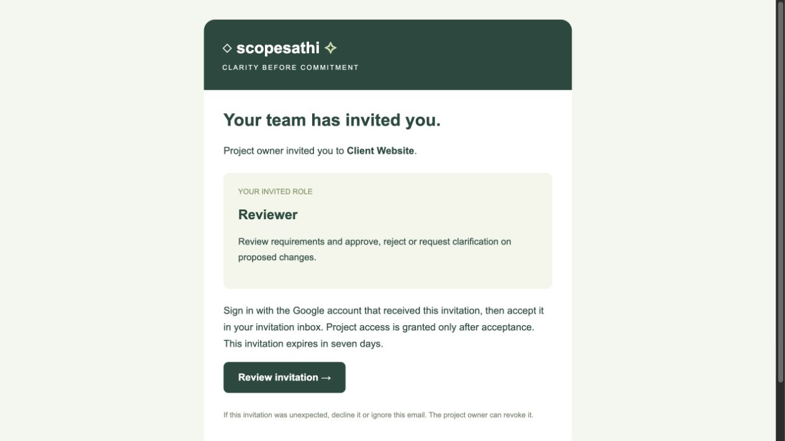
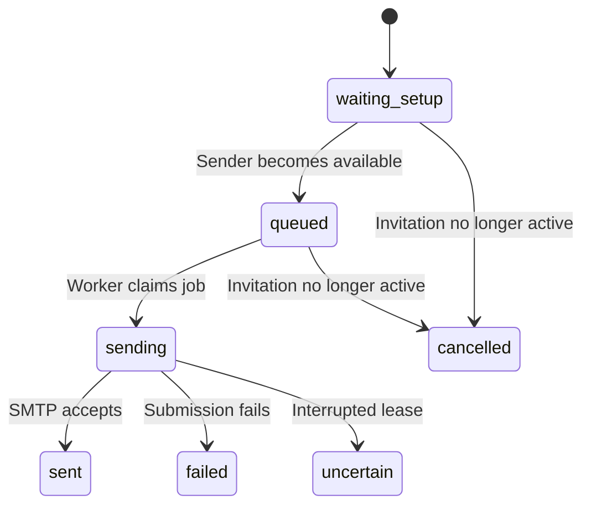

# ScopeSathi email delivery

Welcome, invitation and active-access notifications are persisted in Firestore. In-app invitations work even when mail is not configured. Registered recipients must be enabled, verified Google accounts. If an address is not registered, the owner must confirm a signup invitation. Recipients accept or decline using the matching verified Google account; new project access is granted only after acceptance. Invitations expire after seven days and can be revoked by the owner.

[Documentation home](README.md)



This browser-rendered template uses demonstration content; it is not an inbox delivery receipt.

Existing project permissions remain intact. On their next login, existing teammates get a role notice in their inbox. A role badge also appears beside the project name.

## Current Cloud Run installation

Live origin: **https://scopesathi-api-112358672382.europe-west1.run.app**. Welcome, invitation, access and membership links use this origin at send time in the known google-mode deployment. Set `APP_PUBLIC_URL` explicitly in Cloud Run.

For hosted delivery, follow **[Secret Manager and authenticated Scheduler setup](CLOUD_RUN_RELEASE.md#configure-hosted-email-without-exposing-the-password)**. GitHub does not upload your local SMTP settings. No hosted SMTP test has been performed by preparing this release.

## Configure a local sender

For Gmail, use an account that has two-step verification and supports app passwords. Create a dedicated app password in Google Account settings. This is separate from your Google account password and Firebase Admin credential. Never paste either password into chat.

Save the app password in a private text file outside this project. Then run:

```
npm run email:configure -- sender@gmail.com /absolute/path/to/private-password.txt https://scopesathi-api-112358672382.europe-west1.run.app
```

The script verifies SMTP access and stores the settings only in ignored local `.env`. It sends no test email. Restart the backend after setup. The public URL must be the actual HTTPS address where recipients can access your ScopeSathi app. Localhost is not reachable from a teammate’s computer. Without that URL, delivery waits for setup unless explicit local-test mode is enabled as described below.

The app uses smtp.gmail.com on port 465 with TLS. Keep EMAIL_ENABLED=false if you want in-app notifications without automatic mail. Enabling delivery releases waiting welcome and active pending-invitation emails; expired/revoked/decided invitations are cancelled. SMTP acceptance is labelled as submission, not proof of inbox delivery.

## Delivery status



The diagram describes delivery states, not inbox guarantees. Welcome deduplication is transactional, while SMTP delivery cannot guarantee exactly once across a crash.

- waiting_setup: sender or public app URL is missing; no email was sent.
- queued: awaiting the backend worker.
- sending: sender submission is in progress.
- sent: SMTP accepted the message; check spam if it is not visible.
- failed: submission was not confirmed. Check the sender account before retrying.
- uncertain: the worker was interrupted; check the sender account to avoid duplicates.
- cancelled: the invitation is no longer active.

There is no automatic resend after a failed or uncertain submission. The app avoids claiming exact-once mail delivery, which SMTP cannot guarantee across crashes. Local polling runs only while the backend is running. Cloud Run disables that polling loop and uses `POST /api/internal/mail/drain`, authenticated using Google-signed OIDC for the exact `MAIL_TRIGGER_SERVICE_ACCOUNT` and public-origin audience. Each invocation processes at most one queued job inside the request. Jobs persist in Firestore across restarts; configure the Scheduler before relying on hosted delivery.

The HTML templates include branding, the inviter and project, a role explanation, next steps, a call-to-action, expiry information and a plain-text alternative. User-supplied text is escaped. The previews use an example URL and are not sent emails.

Official setup references:
- https://support.google.com/accounts/answer/185833
- https://nodemailer.com/guides/using-gmail

## Local email testing
EMAIL_LOCAL_TEST=true with APP_MODE=firebase allows automatic styled emails without a public URL. EMAIL_ENABLED=true and SMTP credentials are still required. Messages explicitly explain that the app runs on the host Mac. This mode is blocked in Cloud Run. Queued welcome messages are released when enabled. Unknown recipients may be invited after owner confirmation; a verified Google session matching the address is required to accept. Email format validation cannot establish whether a mailbox exists.
