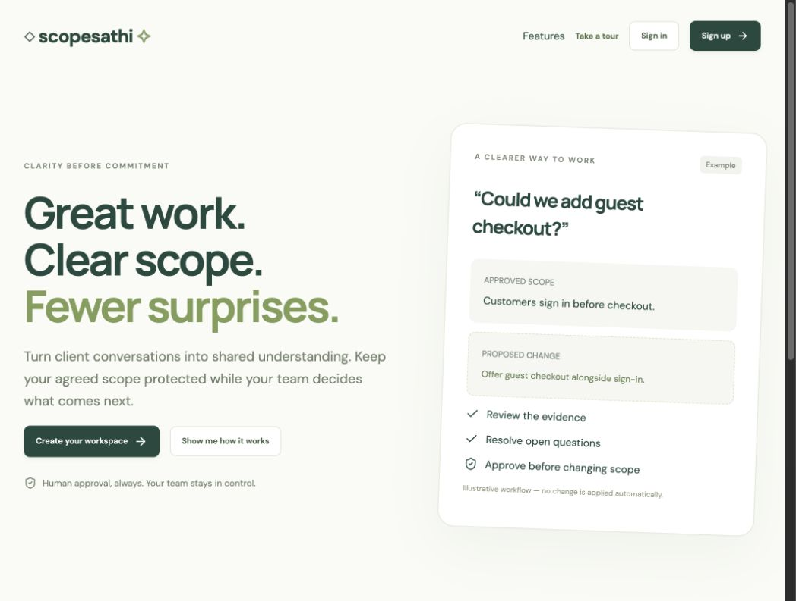
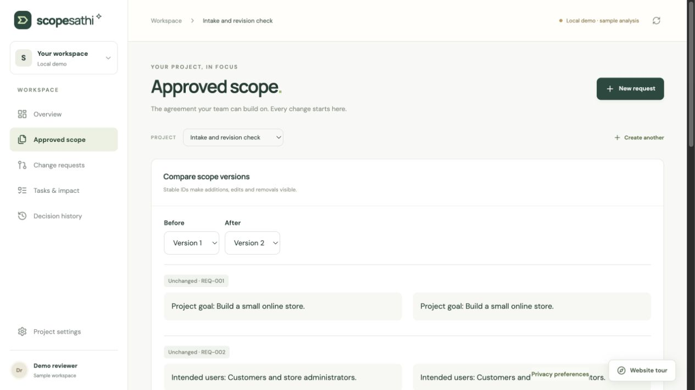
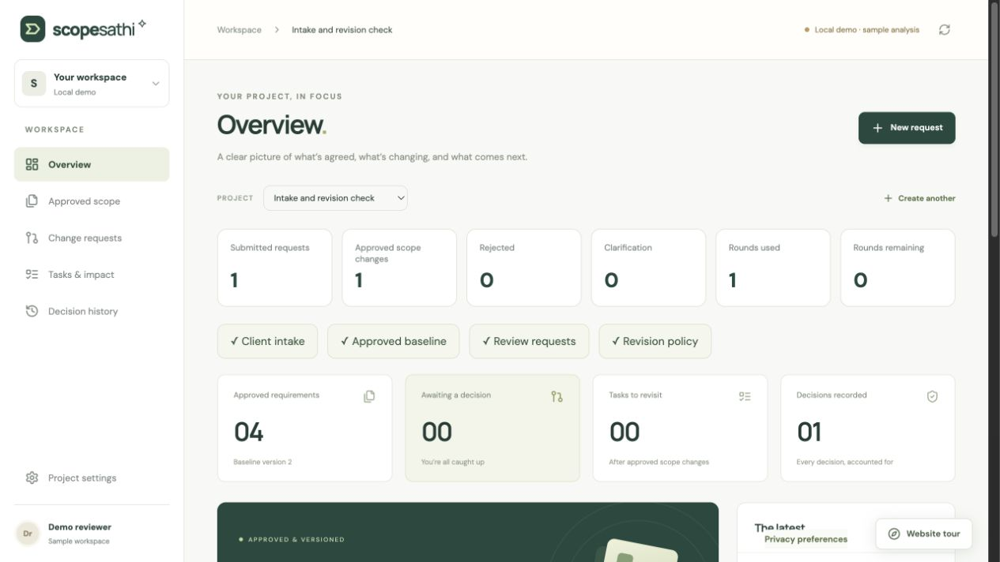
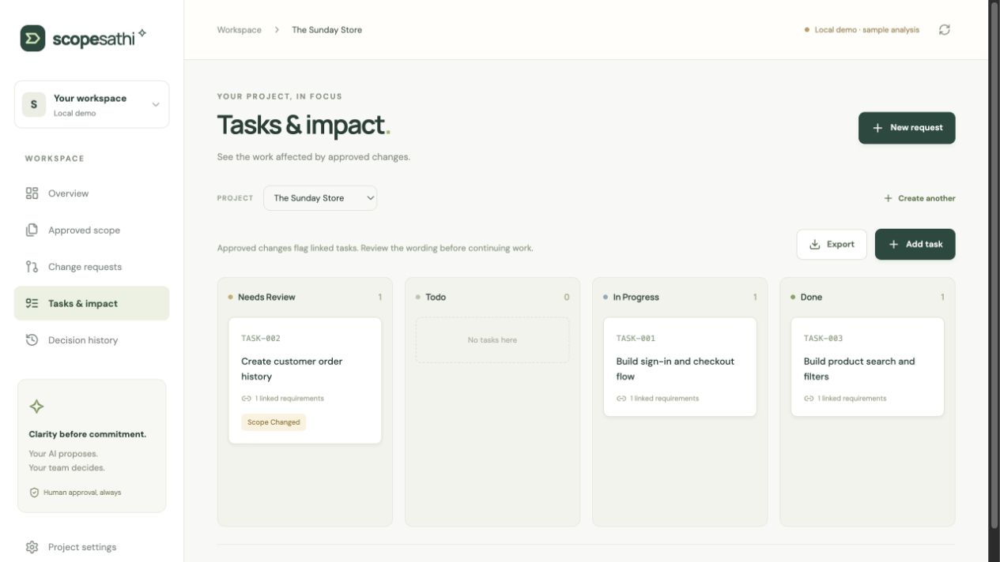
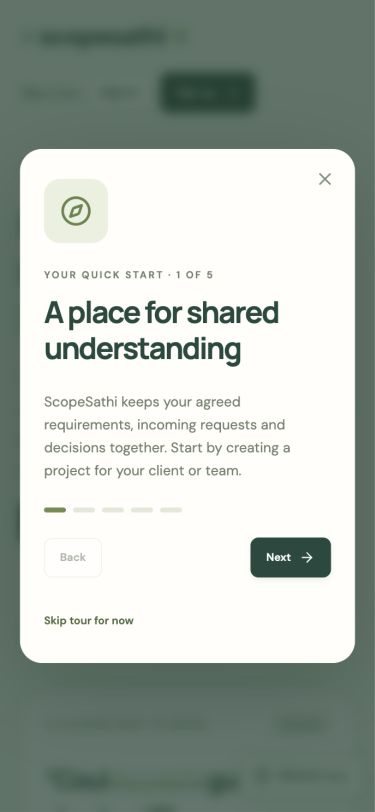

# Product guide

[Documentation home](README.md)

ScopeSathi preserves the original agreement while a team reviews later client requests. It records evidence and decisions; it does not determine legal obligations or charge a client.

## Home, sign-in and tour

The home page introduces the approval workflow. Sign-in and sign-up both use Google authentication, not a separate password database. Session persistence is the default; remember-me uses Firebase local persistence. Optional tour remembrance is separate. There are no advertising or analytics cookies implemented.

## Capture the baseline

Create a project and open Approved scope. Record the goal, users, features, deliverables, constraints, acceptance criteria and excluded work. Paste a brief or upload a selectable-text PDF/TXT. Review extracted wording and exact quotes before approving baseline version 1.

Limits: 2 MB uploads, 16,000-character briefs and 30 extracted requirements. Scanned PDFs need external OCR. Original file bytes are discarded after extraction; retained source text is not an archival PDF copy. Approved intake is frozen by the workflow; later changes go through requests.

## Compare incoming requests

Record the message, title and source. Findings contain requirement references, baseline quotes, request quotes, proposed wording, questions and task links. One request can have multiple findings.

| Classification | Meaning |
| --- | --- |
| Addition | Proposed new requirement |
| Modification | Proposed replacement wording |
| Removal | Proposed removal |
| Clarification | Unresolved question |
| No change | No baseline amendment needed |

Configured Gemini proposes findings. Without it, review is explicitly manual. The known demo scenario uses labelled prepared output. Resolve ambiguity and save the proposal; proposal editing does not approve it.

## Decide and compare versions

Owners/reviewers record a reason and approve, reject or request clarification. Approval checks current revisions, source evidence and unresolved questions. Previous snapshots remain available. Clarification is a terminal decision; submit a follow-up request to preserve the earlier record.

## Track revision rounds

The owner configures an allowance and round definition. Related requests share a round. Multiple approved new-scope requests in one round consume it once. Corrections, rejection, clarification and no-change findings do not consume allowance. Beyond-allowance approval requires a recorded separate agreement; it does not create an invoice. `null` means unlimited; zero means no included new-scope rounds.

## Review task impact and export

Tasks link to requirements. Approval flags affected tasks as `needs_review`, rather than silently rewriting them. A member with write access reviews the task and updates its status. Tasks export as CSV; scope and history export as JSON. Exports are snapshots, not full database backups or an import format.

## Invite collaborators

Owners invite reviewers, editors or viewers. Pending invitations grant no access. Registered recipients must be enabled, verified Google users. Unknown addresses require owner confirmation to send a signup invitation. Acceptance uses the matching verified account; invitations expire after seven days and can be revoked. Email syntax checks cannot prove a mailbox exists.

This is a template preview, not inbox delivery evidence. In-app notifications work independently of a configured sender. See [email setup](EMAIL_SETUP.md).

## Onboarding on mobile

Reopen the tour from the interface. Each workspace tab has a relevant empty state. Account and connection settings are available before creating a project. Loading transitions respect reduced-motion preferences.

No OCR, meeting recording, Jira synchronization, automatic billing, automatic approvals or code modification is implemented. Live model accuracy and production capacity require separate evaluation.

## Estimate additional work

The cost meter in Overview, Change requests and Settings shows included rounds, pending extra work and quote totals. Owners set currency, price and the designated client in Revision policy after accepted project access. Reviewers propose priced extra rounds; the client accepts or declines before scope approval. Owners can record an existing invoice reference after approval. See [the pricing guide](REVISION_PRICING.md).

## Reviewed amendments and workspace improvements

Approved scope is preserved history, so it is changed through **Propose edit** or **Propose removal**, rather than an unrecorded overwrite. Enter replacement wording (for edits), the exact client request or a team correction explanation, and classify the change. Submit it for review; only approval applies a new version. IDs survive edits, old versions remain available, and linked tasks are flagged. Old heading/footer entries can be removed as reviewed extraction corrections when they were never part of the agreement.

**Change requests** now begins with a direct submission action and explains the message → comparison → decision workflow. Search includes title, source, request text and affected requirement IDs. Rows show findings and open clarification counts. Manual proposals open in their editor so reviewers can complete them; there is no claim of live AI.

**Tasks & impact** shows linked-scope coverage, unlinked work, completed work and pending reviews. Preview a deterministic task plan for uncovered feature requirements; edit/select the task titles before saving. This is not an AI estimate. Existing tasks are not overwritten, and duplicate plans are rejected. Task cards display actual requirement wording and the approved request affecting the work. Descriptions, review notes and status updates persist; moving a task out of Needs Review requires a review note. Viewers can inspect task details without write access.

**Decision history** combines baseline approvals and request decisions chronologically, with reasons, reviewers and evidence links. Search/filter activity, access, task and pricing records separately. The archive and decision trail are independently focusable bounded scroll regions. Scroll chaining is contained; the whole page still scrolls when the pointer is outside those regions.

Version comparison starts with the latest change, hides unchanged clauses by default and uses a bounded region. A single version explains that there is nothing to compare yet. Revision-cost details are available in a collapsible panel so they do not hide the section's main action.

Existing saved projects and approved baselines are not automatically rewritten by these UI improvements.

## Review, traceability and client report

Overview highlights the next useful step. Expand **Explore request-to-task traceability** to follow saved requests through requirements, decisions and currently linked work. New approved scope changes record their resulting version; older records are not assigned invented result versions.

A request review shows exact passages and a bounded wording diff with deletions and additions. Task impact includes explicit requirement links even if the model omitted task IDs. Historical views use the request baseline, not the latest amended clause. Matching text is evidence of presence, not proof of correct interpretation.

Choose **Preview client report** to inspect the saved request, wording, evidence, questions, decision and round quote. Unsaved proposal edits are excluded. Decision notes are opt-in; member lists, invoice references and internal activity are omitted. **Print / save PDF** uses the browser print dialog; inspect pages before sharing. This does not email a report or generate an invoice.

The public home page offers **Explore a worked example**, a five-step illustration requiring no sign-in and saving no data. It is separate from live AI and does not create a project. Notification polling pauses while the tab is hidden.
# Evidence navigation and client guidance

In a request review, expand **Locate incoming evidence** or **Locate agreed wording** to see the exact passage highlighted in retained text. A matching original-brief passage is available when the requirement's source quote still exists there. Repeated matches are labeled; line numbers refer to extracted text rather than PDF pages. This context stays in the authenticated review and is excluded from the client report.

Overview guides a designated client with a current proposed round quote to Revision allowance for acceptance or decline. Other viewers receive read-only decision-history guidance. The traceability table shows recorded reviewers and current/stale round consent beside version and task links. Quote acceptance does not approve scope or prove payment.
