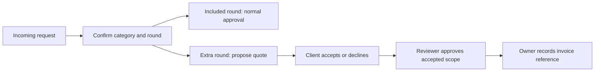

# Revision allowance and cost meter

ScopeSathi prices extra **revision rounds** after the owner's included allowance. A round groups related requests and counts once when a reviewer approves new scope. This feature records estimates, client consent and invoice references; it does not process payments or generate invoices.

## Configure five included rounds and a price

1. Open **Settings → Project access**, invite the client and wait for them to accept. Viewer access is sufficient to respond to quotes.
2. Under **Revision policy**, set **Included rounds = 5**.
3. Set the **Additional round price**, for example **500**, and choose **INR**. Supported currencies are INR, USD, EUR and GBP.
4. Select the client account that will accept estimates.
5. Define what a round means in your agreement, then save the policy.

Positive pricing requires a finite allowance and a separate client with accepted project membership. Zero price preserves the existing workflow: extra scope requires a reviewer-recorded agreement rather than a priced quote.

## Review an extra round

The cost meter appears in **Overview**, **Change requests** and **Settings**.

- Corrections needed to meet the original agreement are free.
- Rejected requests, clarification and no-change decisions consume no allowance.
- Related requests share one round and one extra-round price.
- The reviewer confirms requirement evidence, classification and grouping before proposing a quote.
- The client signs in with their account, selects the shared project and reviews the exact quoted scope in the cost meter.
- The client chooses **Accept** or **Decline**. Refresh the project in the other account to see the response.
- Scope approval remains a separate reviewer action. The accepted quote supplies the recorded separate agreement.
- Changed requests, comparisons or grouping require an updated quote and fresh acceptance. The previously accepted rate stays fixed for that round.
- After all quoted requests are approved, the owner can record an existing invoice reference. Use a new round for further scope after invoicing.
- Quote emails and payment collection are not implemented. Existing welcome and invitation emails retain their behavior.

## Read the meter

| Display | Meaning |
|---|---|
| Included rounds used / remaining | Approved new-scope rounds compared with the allowance |
| Approved beyond allowance | Additional approved rounds |
| Pending beyond allowance | New pending rounds currently exceeding allowance; these do not reserve allowance |
| Unquoted extra-work estimate | Current price times extra rounds without formal quotes |
| Estimated | Current proposed quotes awaiting consent |
| Client accepted | Current accepted quotes, including those later invoiced |
| Invoiced | Accepted rounds with an owner-recorded invoice reference |

Currencies are totaled separately. Accepted and invoiced totals overlap and should not be added. Stale quotes are excluded from current estimated/accepted totals until renewed. Previous versions remain in the project and history. No payment-received status is inferred.

## Permissions and persistence

Owners configure prices, allowance, designated client and invoice references. Reviewers propose quotes and approve scope. Only the designated client with active project access can accept or decline. Viewers can consent without gaining editing or approval permissions.

Quotes capture a fixed amount in integer minor units, currency, client, exact scope, request IDs, proposal identity and timestamps. Responses and invoice references are recorded in history. Policy updates do not rewrite accepted prices. API mutations use existing project revision and Firestore transaction protection. Project exports include quotes; old projects load with empty quote history and no configured charge.

## Verification and limits

Automated tests cover free rounds, corrections, client-only consent, decline, changed scope, fixed accepted prices, grouping, invoice prerequisites, duplicates, revoked access, canonical scope ordering, API schemas and stale revisions. The live Firestore test exercises acceptance, approval, invoice persistence and a fresh-process read with a disposable fixture.

This remains a bounded prototype using whole-project storage limits. Taxes, discounts, invoice generation, online payments, refunds and quote mail are not included. Service tests use validation actors; actual client Google sign-in and UI layout require separate browser verification.
